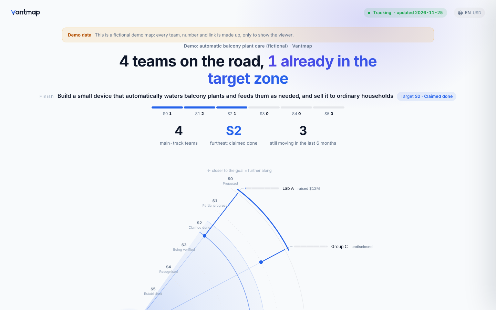

# Vantmap — verified progress maps for any research direction

**English** · [简体中文](README.zh-CN.md)



**Live demo:** https://alfryr116070-blip.github.io/vantmap/

Ask an AI "who is building X and how far have they got?" and you get a confident paragraph you can't check.
Vantmap turns that question into a **map**: every team working toward a goal, the stage it has reached (S0–S5),
and for every claim the **source link, a verbatim quote, an evidence grade and the date it was checked**.
One command updates it incrementally (run it daily by hand or on your own schedule), and it only spends money when something actually changed.

> The repo ships **one fictional demo map** (every team, number and link in it is made up) so you can see the viewer in 8 languages.
> Build real maps for your own directions with `/vantmap:vantmap-new-map`.
> Serve the folder (`python3 -m http.server`) or use the GitHub Pages site — opening `index.html` straight from disk won't load the data.

## What makes it different

| | Asking an AI directly | Vantmap |
|---|---|---|
| Every claim has a link + verbatim quote | rarely | **always** (checked by script) |
| Independent verification | no | two blind judges + online spot checks + sampled acceptance |
| Honest about what isn't verified | no | three tiers, "not passed" banners, real audit numbers on the page |
| Tomorrow | starts from zero | daily incremental update, changes flagged |
| Cost per daily update | — | cheap model screens fixed sources; expensive model only on hits |

## How it works

```
fixed sources ──► cheap screen (haiku) ──► feed.py: dedupe · cluster · match ──► hits only
                                                                         │
             tier 3: leads (title + link, no claims) ◄── unmatched ──────┤
                                                                         ▼
          tier 2: watch list ◄── light check          draft (sonnet) → cache_check.py →
          tier 1: main map   ◄── two blind judges (opus) + ≥20% online check → check.py → publish
```

- **Tier 1 — main map.** Fully verified. All stats and the AI briefing use only this tier.
- **Tier 2 — watch list.** Guarantees only that the team exists and the one-line description matches its source; the stage is a rough call. Money and regulatory claims get a second online check (`key_checked`).
- **Tier 3 — leads.** Links picked up by the feed, not yet opened. No claims at all.

Map content is authored in Chinese and translated (English + 6 languages ship with the repo); the prompt templates and script messages are Chinese — agents read them fine, and English versions are welcome. Chinese originals of the docs are in [docs/zh-CN](docs/zh-CN/).

Full rules: [docs/pipeline.md](docs/pipeline.md) · evidence rubric: [docs/rubric.md](docs/rubric.md) · data format: [docs/schema.md](docs/schema.md).

## Quick start (5 minutes)

**Browse the demo map**

```bash
git clone https://github.com/alfryr116070-blip/vantmap && cd vantmap
python3 -m http.server 8000      # then open http://localhost:8000
```

**Check a map** (no API key needed)

```bash
python3 tools/check.py data/maps/demo/map.json 2026-11-25
python3 tools/derive.py data/maps/demo/map.json 2026-11-25   # recompute milestones from evidence
```

**Run the daily update with Claude Code**

```bash
claude plugin marketplace add alfryr116070-blip/vantmap     # or: claude plugin marketplace add ./  (from a clone)
claude plugin install vantmap@vantmap
claude                                           # start a session in the repo root
> /vantmap:vantmap-daily
```

The agent follows [docs/daily.md](docs/daily.md). It needs sub-agents, web search and web fetch.

**Make a new map** — run `/vantmap:vantmap-new-map` in Claude Code and give it your goal. See [docs/new-map.md](docs/new-map.md).

**No coding tools?** Use the ChatGPT version in [integrations/chatgpt](integrations/chatgpt/README.md): paste one prompt, get a JSON map, drop it into a standalone viewer. (The prompt and that viewer are currently Chinese-only; the prompt tells ChatGPT to talk to you in your language.)

## Accuracy — how it is measured

The standard: **no wrong or unsupported data; minor slips ≤4%.** Anything without a source is removed, not kept.

- **Acceptance:** after a map is built, an agent that wrote nothing re-opens a random sample of 50–100 tier-1 claims online and grades each one correct / minor / wrong / unsupported. A map that misses the bar is published with a **"not passed"** banner and its real numbers, never hidden.
- **Weekly spot check:** facts go stale (market caps, "latest" releases), so a fresh sample is re-checked every week and fixes are logged in the map's corrections.
- Every map's numbers are in its **Method** section in the viewer.

## Keeping full-page evidence

`tools/fetch_archive.py` saves the full text of every cited page (robots.txt respected) and checks that each quote really appears there. Keep the archive for verification; don't republish it.

## Cost

`tools/cost.py` prices every recorded run. Exact when runs record token usage (`usage_by_model`), clearly labelled as an estimate otherwise. A typical daily run uses mostly small-model screening; large models only see hits.

## Repository layout

```
index.html            standalone viewer (no build step, no server code)
data/                 maps.json + one folder per map (map.json, en.json, feed.json), i18n/ for 6 more languages
tools/                check.py · derive.py · feed.py · cache_check.py · fetch_archive.py · cost.py · i18n_*.py · …
prompts/              prompt templates for every sub-agent role
docs/                 pipeline · daily run · new map · rubric · schema
plugins/vantmap/      Claude Code plugin (skills + agents); .claude-plugin/marketplace.json at the root
integrations/chatgpt/ ChatGPT prompt + standalone viewer
tests/                pytest for the scripts
```

## Publish your own maps on GitHub Pages

Fork, then Settings → Pages → Source: **GitHub Actions**. `.github/workflows/pages.yml` publishes `index.html` and `data/` on every push to `main`.

## Contributing

New maps, source lists, corrections and translations are all welcome — see [CONTRIBUTING.md](CONTRIBUTING.md).
Found a wrong claim? Open a **Correction** issue with the claim and the page that contradicts it; it is re-checked by an agent that didn't write it.

## License

Code: [MIT](LICENSE). Map data (`data/`): [CC BY 4.0](DATA_LICENSE.md) — quotes inside the data are short excerpts from their linked sources and remain the property of their owners.
