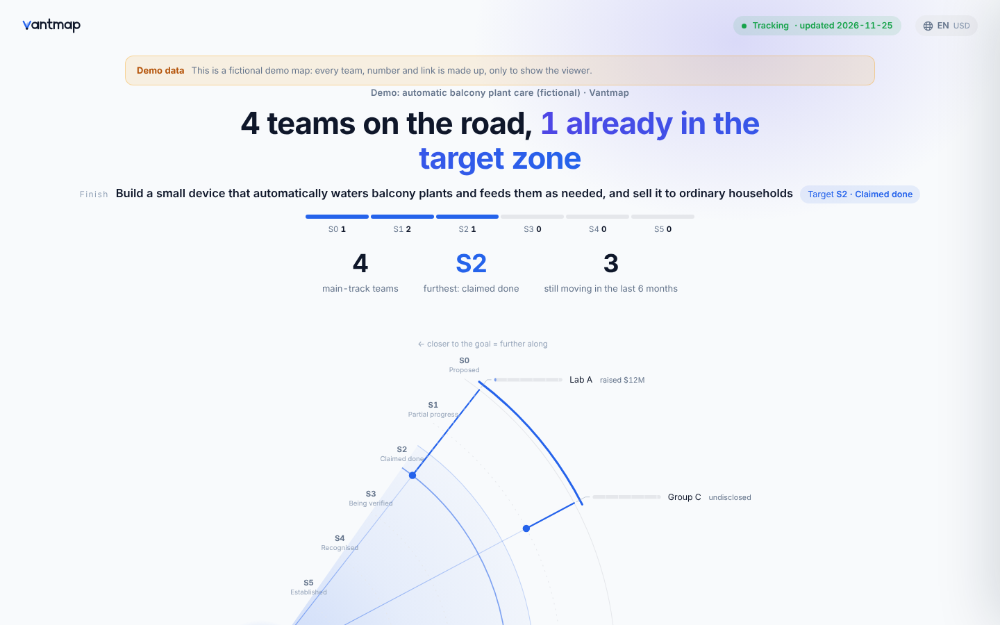

# 先瞰 Vantmap —— 任何研究方向的“可核实进度地图”

[English](README.md) · **简体中文**



**在线演示：** https://alfryr116070-blip.github.io/vantmap/

问 AI“谁在做 X、做到哪一步了？”，你会得到一段很自信、但没法核对的话。
先瞰把这个问题变成一张**地图**：朝同一目标努力的每个团队、各自到了哪一阶段（S0–S5），
而且每一条说法都带着**出处链接、原文引语、证据等级和核对日期**。一条命令就能增量更新（每天手动跑或按你自己的计划定时跑），只有真有变化时才花钱。

> 仓库只带**一张虚构的演示地图**（里面的团队、数字和链接都是编的），用来展示查看器，支持 8 种语言。
> 你自己的方向用 `/vantmap:vantmap-new-map` 生成真实地图。
> 用 `python3 -m http.server` 启动本地服务或打开 GitHub Pages 页面浏览（直接双击 `index.html` 读不到数据）。

## 和直接问 AI 有什么不同

| | 直接问 AI | 先瞰 |
|---|---|---|
| 每条说法都有链接和原文引语 | 很少 | **一定有**（脚本检查） |
| 独立核查 | 没有 | 两路盲审 + 联网抽查 + 抽样验收 |
| 说清楚哪些没核实 | 不会 | 三层分级、“未通过”横幅、页面上公开真实审计数字 |
| 明天再问 | 从零开始 | 每日增量更新，变化单独标出 |
| 每日更新成本 | — | 便宜模型筛固定来源，贵模型只看命中 |

## 工作方式

- **第一层·主图**：完整核实。所有统计和 AI 解读只用这一层。
- **第二层·观察名单**：只保证团队存在、一句话描述与来源一致；阶段是粗判。涉及金额、监管结论的说法再联网核对一次（`key_checked`）。
- **第三层·线索**：信息流抓到、还没打开的链接，不含任何结论。

完整规则见 [docs/pipeline.md](docs/pipeline.md)，证据评级见 [docs/rubric.md](docs/rubric.md)，数据格式见 [docs/schema.md](docs/schema.md)。

## 快速开始

**浏览演示地图**

```bash
git clone https://github.com/alfryr116070-blip/vantmap && cd vantmap
python3 -m http.server 8000      # 然后打开 http://localhost:8000
```

**检查一张地图**（不需要 API key）

```bash
python3 tools/check.py data/maps/demo/map.json 2026-11-25
```

**用 Claude Code 跑每日更新**

```bash
claude plugin marketplace add alfryr116070-blip/vantmap
claude plugin install vantmap@vantmap
claude
> /vantmap:vantmap-daily
```

**新建一张地图**：在 Claude Code 里运行 `/vantmap:vantmap-new-map`，说出你的目标。

**不写代码？** 用 [integrations/chatgpt](integrations/chatgpt/README.md) 里的 ChatGPT 版：粘贴一段指令，得到 JSON，拖进离线查看器。

## 准确性：怎么衡量

标准：**不能有错误或没有依据的数据；小错 ≤4%。** 找不到出处的内容直接删除。

- **验收**：地图建好后，由一个没写过任何内容的代理随机抽 50–100 条第一层说法联网重查，逐条判正确、小错、错误或没有依据。没达标的地图照样发布，但带“未通过”横幅和真实数字，不隐藏。
- **每周抽查**：事实会过时（市值、“最新”版本），所以每周再抽一批重查，改正记进地图的更正记录。
- 每张地图的数字都在查看器的“方法”一节里。

## 参与

欢迎新地图、来源清单、纠错和翻译，见 [CONTRIBUTING.md](CONTRIBUTING.md)。发现错误请开 **Correction** issue，附上说法和反驳它的页面，会由没写过这条的代理重新核对。

## 许可

代码：[MIT](LICENSE)。地图数据（`data/`）：[CC BY 4.0](DATA_LICENSE.md)；数据中的引语是来源页面的简短摘录，版权归原作者。
